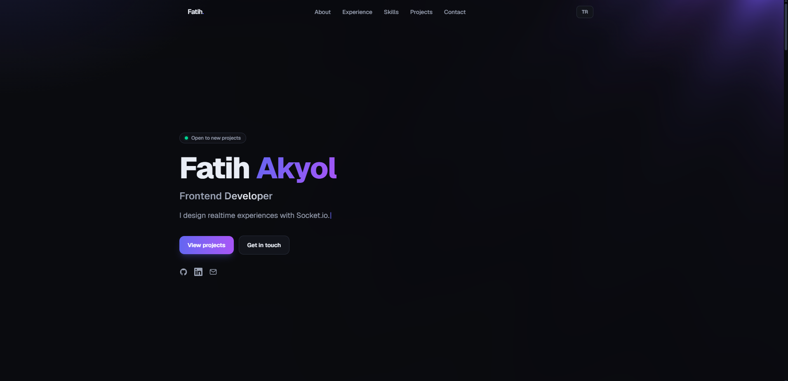

# fatihakyol.com

My personal portfolio — a bilingual (EN/TR) single-page site showcasing the
products I build and ship: a real-time chat platform, video conferencing,
a collaborative whiteboard, a browser code editor, and more. Every project
links to a **live demo** and its source repository.

**Live:** [fatihakyol.com](https://fatihakyol.com)



## Features

- Animated hero with a WebGL background (OGL) and motion-driven transitions
- EN / TR language toggle — all content is data-driven from a single typed file
- Project grid with live-demo and repository links for every product
- Fully responsive, keyboard-friendly, fast

## Tech Stack

- **Framework** — Next.js (App Router), React, TypeScript
- **Styling & motion** — Tailwind CSS, Motion (Framer Motion)
- **Graphics** — OGL (WebGL)
- **Deployment** — Docker + nginx

## Getting Started

```bash
npm install
npm run dev               # http://localhost:3000
```

Project content (bio, projects, links) lives in [`data/content.ts`](data/content.ts) —
edit that single file to update the site.

## Deployment

Built as a standalone Next.js output and served from a Docker container behind
the host nginx, which terminates TLS.

```bash
docker compose -f docker-compose.prod.yml up -d --build
```

## License

MIT
